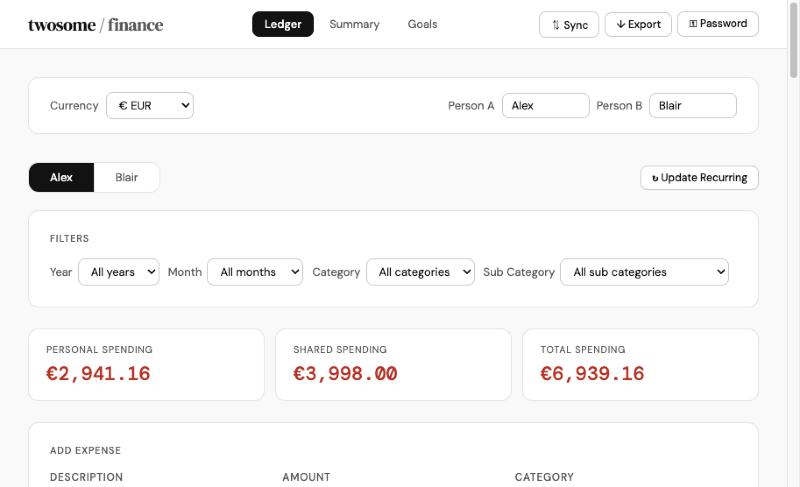
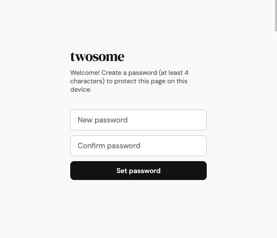
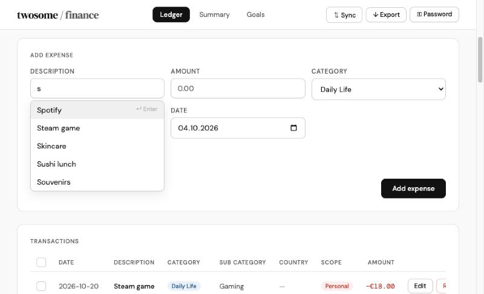
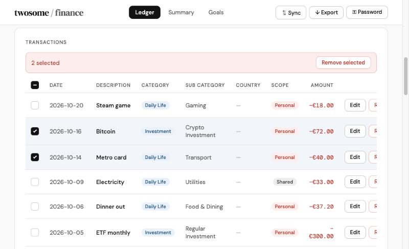
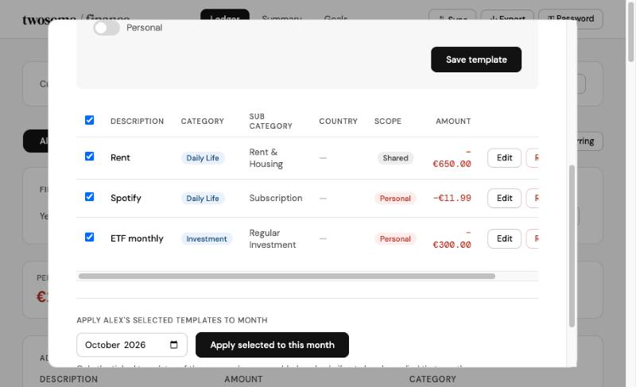
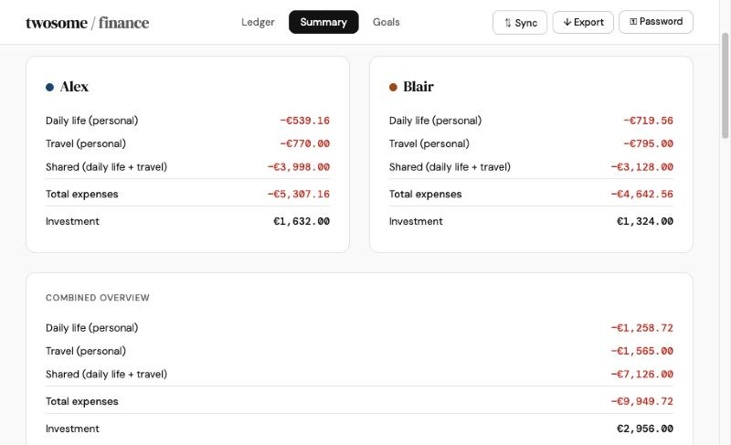
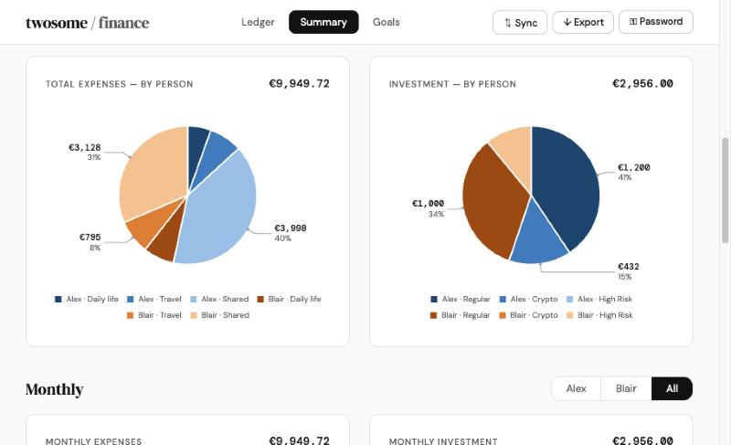
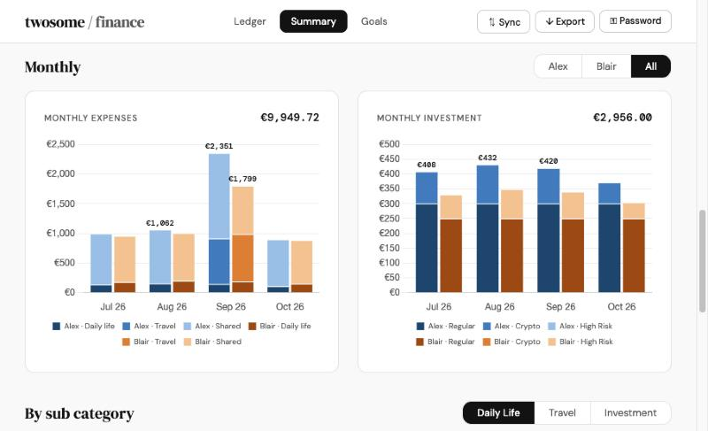
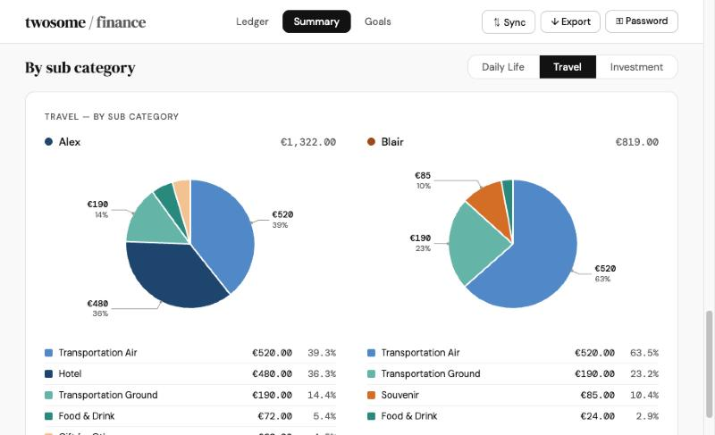
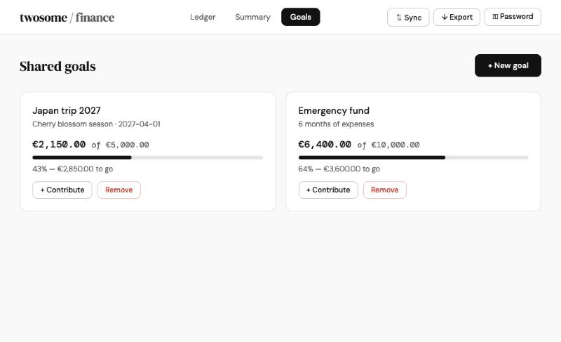

# twosome — couple finance

A private, single-page web app for two people to track their **expenses** and **investments** together:
a shared ledger, clear summaries with charts, recurring templates and savings goals.

Everything runs in the browser. There is no server and no account: your records never leave your device unless you export them.



> All screenshots use made-up sample data (a couple named Alex & Blair).

---

## Features at a glance

| Area | What you can do |
|---|---|
| **Ledger** | Add, edit and remove expenses per person; filter by year, month, category and sub category; select several rows and remove them at once |
| **Description autofill** | Start typing and pick a description you've used before (Enter or click) |
| **Recurring** | Save monthly templates per person and apply the ones you tick to any month |
| **Summary** | Totals per person and combined, expense and investment pies, monthly bars with a person toggle, sub-category breakdowns |
| **Goals** | Shared savings goals with progress bars and contributions |
| **Sync & Export** | Swap a JSON file with your partner to merge data; export CSV for spreadsheets |
| **Password** | Each device sets its own password; the page locks itself after 5 minutes of inactivity |

---

## How it looks

### Sign in
The first visit on a device asks you to create a password. Later visits show a normal login.



### Ledger
Switch between the two people, filter the list (a **Clear all** button appears when any filter is on), and see personal / shared / total spending at a glance.


**Add expense with autofill.** Descriptions you've typed before are suggested as you type. Matching ignores upper/lower case, suggestions start with a capital letter, and **Enter** picks the highlighted one.



**Transactions.** Tick the box on the left of any row to select it; the header box selects all. Selected rows can be removed together.



### Recurring expenses
Open **↻ Update Recurring**. Each person has their own tab of templates. Tick the ones you want, choose a month and apply. Entries are dated the 1st of that month, and a template is never added twice to the same month.



### Summary
**Totals.** For each person and combined, broken down into *Daily life (personal)*, *Travel (personal)*, *Shared (daily life + travel)*, **Total expenses**, and **Investment** on its own line.



**Expenses and investment pies.** Person 1 is always blue and person 2 always amber. The three largest slices are labelled outside the pie, and the labels re-position themselves automatically when the numbers change. Each chart shows its total in the top-right corner.



**Monthly charts.** Monthly expenses and monthly investment side by side. The toggle shows one person or **All** (one bar per person each month). The three tallest bars are labelled.



**By sub category.** Toggle between **Daily Life**, **Travel** and **Investment** to see each person's breakdown, with a legend listing every sub category, its amount and share.



### Goals



---

## How it works

### One file, no server
The whole app is a single file: [`twosome-finance_v10.html`](twosome-finance_v10.html). It loads fonts from Google Fonts and [Chart.js](https://www.chartjs.org/) from a CDN; everything else is inside the file.

### Where your data lives
Records are saved in the browser's **localStorage** on the device you use. Nothing is uploaded anywhere.
- Each browser on each device has its **own copy** of the data.
- To combine data between partners, use **⇅ Sync**: one person downloads a JSON file and sends it, the other imports it. Imports **merge**: new entries are added, existing ones are never overwritten.
- **↓ Export** creates a CSV (for Excel / Google Sheets) or a JSON backup.

### Expenses vs investment
- **Expenses** = everything except the *Investment* category (Daily Life + Travel).
- **Investment** = the *Investment* category only, always shown separately.

| Category | Sub categories |
|---|---|
| Daily Life | Food (Groceries, Food & Dining, Tea, Supplement) · Home & Life (Rent & Housing, Utilities, Furniture, Insurance, Subscription) · Shopping (Clothing, Skincare, Gaming, Pokemon, Gifts, Extra Shopping) · Other (Hobby, Photography, Transport, Health, Entertainment, Education, Other) |
| Travel | Hotel, Food & Drink, Transportation Ground, Transportation Air, Souvenir, Gift for Others, Shopping, Encargo (+ country) |
| Investment | Regular Investment, Crypto Investment, High Risk Investment |

### Password and auto-lock
- On the first visit, each device creates its own password. Only a salted **PBKDF2-SHA-256 hash** is stored, never the password itself, and it is never included in Sync or Export.
- **⚿ Password** in the header lets you change it (current password required).
- After **5 minutes** without mouse, keyboard, scroll or touch activity, the page locks and asks for the password again. Unlocking returns you to where you were.
- There is no "forgot password" reset. If a password is lost, clearing the site's data in the browser resets it, but that also deletes that device's records, so **export a JSON backup regularly**.

> The password keeps casual eyes out on a shared device; it is not encryption. Someone with full access to the device and the browser's developer tools could still read the stored data.

---

## Getting started

**Try it locally:** open `twosome-finance_v10.html` in a browser.
For the password feature, use a modern browser on `https://` or `http://localhost`; for example, from this folder:

```bash
python3 -m http.server 8000
```

then open <http://localhost:8000/twosome-finance_v10.html>.

**Deploy:** upload the HTML file to any static host (GitHub Pages, Netlify, Cloudflare Pages, …).
Use **https** so the browser allows secure password storage.

**Tips**
- On iPhone/iPad, use *Share → Add to Home Screen*: Safari may delete stored data for websites you haven't opened for 7 days, but not for Home Screen apps.
- Export a JSON backup from time to time.

---

## Project structure

```
.
├── twosome-finance_v10.html   # the whole app
├── README.md                  # this file
├── docs/screenshots/          # images used in this README (sample data)
└── .gitignore                 # "elimination list": files git must never save or upload
```

### Keeping secrets out of git
- **`.gitignore`** blocks keys, tokens, `.env` files, anything named *password / secret / credential / token*, and the app's exported data (`twosome_*.json`, `*.csv`), which contains real transactions.
- A local **pre-commit check** (in `.git/hooks/`, not uploaded) refuses a save if new lines look like a key, token or hard-coded password.
